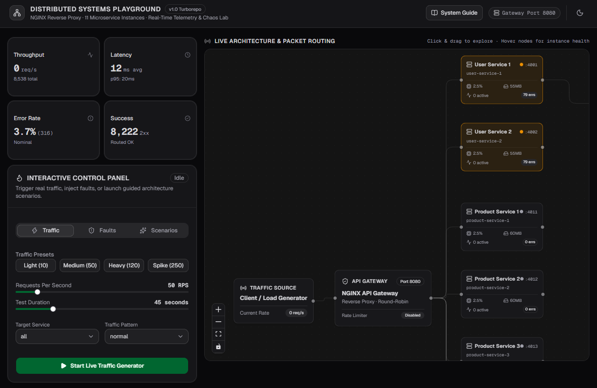
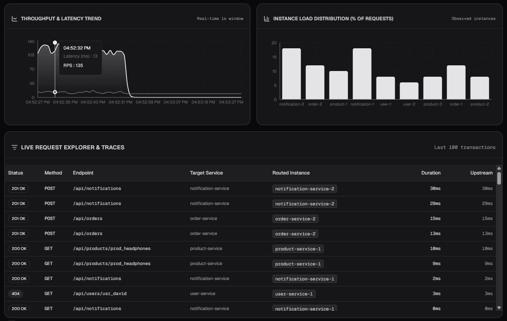
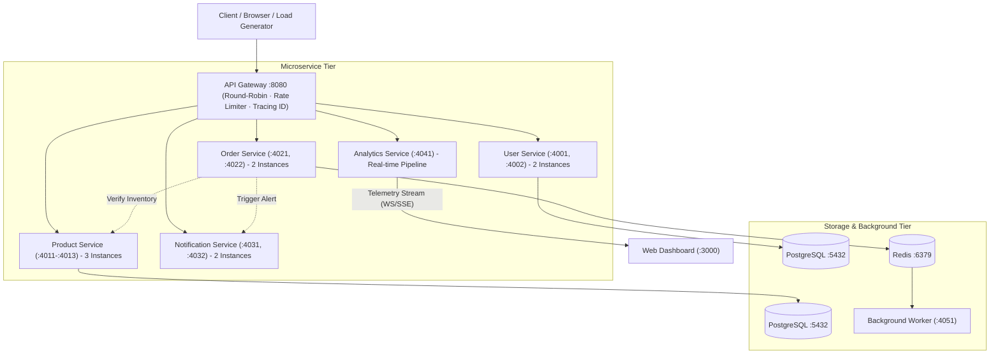

# Microservices Architecture Playground & Observability Visualizer

A local distributed systems simulator and real-time observability visualizer. It runs multiple independent microservices, an API gateway with load balancing, a telemetry aggregation engine, and an interactive Next.js web dashboard with React Flow graph visualization.

This project is designed as a standalone local playground to experiment with distributed architectures, inter-service communication, load balancing patterns, fault injection, and end-to-end distributed tracing.

---

## Visual Overview

### System Architecture & Live Canvas



### Real-Time Metrics & Interactive Controls



---

## What This Playground Does

1. **Simulates a Real Distributed Topology**: Runs 11 distinct microservice processes across independent ports (User, Product, Order, Notification, Worker, Analytics, and API Gateway).
2. **Interactive Traffic Generation**: Generates live synthetic traffic with configurable RPS, durations, and load patterns (steady, burst, ramp-up, spike, uneven distribution).
3. **Chaos Engineering & Fault Injection**: Injects latency delays, error rates, and offline status into specific service instances on the fly to observe cascading failures and circuit breaking.
4. **Real-Time Visual Routing**: Displays live packet animations in a dynamic React Flow canvas as requests route through the gateway to individual instances and storage backends.
5. **Distributed Tracing & Request Explorer**: Stamps requests with unique correlation IDs (`X-Request-ID`) and records full waterfall spans showing inter-service call latency and status codes.
6. **System Metrics**: Visualizes real-time throughput, latency percentiles (p50, p95, p99), error rates, and per-instance load distribution.

---

## System Architecture



### Services and Port Allocations

| Service                  | Port(s)                | Description                                                                     |
| :----------------------- | :--------------------- | :------------------------------------------------------------------------------ |
| **Web Dashboard**        | `3000`                 | Next.js 16 app with React Flow canvas, metrics charts, and control panel        |
| **API Gateway**          | `8080`                 | Reverse proxy with round-robin routing, rate limiting, and request ID stamping  |
| **User Service**         | `4001`, `4002`         | User profiles and authentication data endpoints (2 instances)                   |
| **Product Service**      | `4011`, `4012`, `4013` | Catalog, inventory management, and price queries (3 instances)                  |
| **Order Service**        | `4021`, `4022`         | Transaction coordinator communicating with Product and Notification services    |
| **Notification Service** | `4031`, `4032`         | Asynchronous email and SMS dispatch simulation                                  |
| **Background Worker**    | `4051`                 | Asynchronous job consumer processing tasks from Redis queue                     |
| **Analytics Service**    | `4041`                 | Real-time telemetry ingestion, WebSocket/SSE broadcasting, and chaos controller |

---

## Local Setup and Running

### Prerequisites

- **Node.js**: `v20.0.0` or higher (tested on Node 22 and Node 24)
- **Package Manager**: `pnpm` (version 9 or 11 recommended) or `npm`
- **Operating System**: macOS, Linux, or Windows (PowerShell or Command Prompt)
- _Optional_: Docker Desktop (only required if running via Docker Compose)

### Option 1: Native Local Mode (Recommended)

Run all services natively on your local machine using Turborepo with a single command:

```bash
# 1. Clone the repository
git clone <your-repo-url>
cd micro-visualization

# 2. Install dependencies across all packages
pnpm install

# 3. Start all microservices, the API gateway, and the web dashboard
pnpm dev
```

Once started, open your browser:

- **Web Dashboard**: [http://localhost:3000](http://localhost:3000)
- **API Gateway**: [http://localhost:8080/health](http://localhost:8080/health)
- **Analytics Health**: [http://localhost:4041/health](http://localhost:4041/health)

### Option 2: Docker Compose Mode

If you prefer containerized execution with real Redis and PostgreSQL containers:

```bash
# Build and start all containers in detached mode
docker compose up --build -d

# Check live logs
docker compose logs -f

# Shut down all containers
docker compose down
```

---

## How to Customize and Extend for Your Use Case

The repository is organized as a Turborepo monorepo. Here are common modification scenarios with exact file paths and code examples.

### 1. Modifying Existing Service Logic

To add new routes, mock database queries, or modify business logic in an existing service:

- **Target File**: `services/product-service/src/index.ts` (or `user-service`, `order-service`, etc.)

**Example**: Add a discount calculation endpoint to the Product Service:

```typescript
// In services/product-service/src/index.ts
app.get("/products/:id/discount", (req, res) => {
  const { id } = req.params;
  const discountPercent = Math.floor(Math.random() * 30) + 5;
  res.json({
    productId: id,
    instance: process.env.INSTANCE_ID || "product-service-1",
    discountPercent,
    validUntil: new Date(Date.now() + 86400000).toISOString(),
  });
});
```

The gateway automatically forwards `/api/products/*` routes to all healthy Product Service instances via round-robin.

---

### 2. Adding a New Microservice

To introduce a new microservice (e.g., `payment-service`):

1. **Create the service directory**:
   Create `services/payment-service` with its own `package.json`, `tsconfig.json`, and `src/index.ts` (you can copy `services/user-service` as a starting template).

2. **Add routing to the API Gateway**:
   - **Target File**: `gateway/src/index.ts`
   - Register upstream instances and route definition:

   ```typescript
   // In gateway/src/index.ts
   const PAYMENT_INSTANCES = ["http://localhost:4061", "http://localhost:4062"];

   app.use("/api/payments", (req, res) => {
     forwardRequest(req, res, PAYMENT_INSTANCES, "payment-service");
   });
   ```

3. **Add service start scripts**:
   - Update root `package.json` to include scripts for starting the new instances (`"payment:1"`, `"payment:2"`), and add them to the root `"dev"` pipeline script.

---

### 3. Adding New Nodes or Edges to the Visualizer

To visualize your new service in the interactive canvas:

- **Target File**: `apps/web/src/components/architecture/ArchitectureFlow.tsx`

**Example**: Add node entries into the `nodes` array:

```typescript
// In apps/web/src/components/architecture/ArchitectureFlow.tsx
{
  id: 'payment-service-1',
  type: 'serviceNode',
  position: { x: 580, y: 1450 }, // Use 160px vertical step from preceding node
  data: {
    serviceName: 'Payment Service 1',
    instanceId: 'payment-service-1',
    port: 4061,
    status: 'healthy',
    cpuPercent: 2.1,
    memoryMb: 64,
    activeRequests: 0,
    errorCount: 0,
  },
},
```

And connect it to the Gateway in the `edges` array:

```typescript
{
  id: 'edge-gw-payment-service-1',
  source: 'gateway',
  target: 'payment-service-1',
  type: 'animatedPacket',
  data: { isActive: false, isError: false },
},
```

---

### 4. Adding Custom Chaos Experiments or Scenarios

To define automated resilience tests (e.g., simulating a sudden database lockup or cache eviction):

- **Target File**: `services/analytics-service/src/scenarios.ts`

**Example**: Add a new scenario object to the `PREDEFINED_SCENARIOS` array:

```typescript
// In services/analytics-service/src/scenarios.ts
{
  id: 'payment-gateway-timeout',
  name: 'Payment Gateway Timeout',
  description: 'Simulates high network latency (3500ms) on Payment instances to test client timeout fallbacks.',
  steps: [
    {
      action: 'inject_fault',
      target: 'payment-service',
      payload: { latencyMs: 3500, failureRate: 0.2 },
      delayMs: 0,
    },
    {
      action: 'start_traffic',
      payload: { rps: 80, durationSeconds: 30, pattern: 'spike' },
      delayMs: 2000,
    },
  ],
}
```

The new scenario will automatically appear in the **Interactive Control Panel** under the **Scenarios** tab in the web UI.

---

## Repository Structure

```text
micro-visualization/
├── apps/
│   └── web/                         # Next.js 16 Web Dashboard & UI
│       ├── src/app/                 # App Router pages (/ and /overview)
│       ├── src/components/
│       │   ├── architecture/        # React Flow canvas and custom nodes
│       │   ├── dashboard/           # Metrics cards, charts, and control panel
│       │   └── ui/                  # Shadcn UI primitives
│       └── public/                  # Static assets and screenshots
├── gateway/                         # Reverse Proxy & Load Balancer (Port 8080)
│   └── src/index.ts
├── services/                        # Independent Microservices
│   ├── analytics-service/           # Telemetry pipeline, WS/SSE, chaos controller (Port 4041)
│   ├── notification-service/        # Notifications simulator (Ports 4031, 4032)
│   ├── order-service/               # Order transactions coordinator (Ports 4021, 4022)
│   ├── product-service/             # Product catalog & stock (Ports 4011, 4012, 4013)
│   ├── user-service/                # User accounts & auth (Ports 4001, 4002)
│   └── worker-service/              # Background queue worker (Port 4051)
├── packages/
│   └── shared/                      # Shared TypeScript types, telemetry schemas & utils
├── public/                          # Root visuals referenced in documentation
├── docker-compose.yml               # Optional container setup with Redis & PostgreSQL
├── package.json                     # Monorepo scripts & dependencies
├── pnpm-workspace.yaml              # Workspace package boundaries
└── turbo.json                       # Turborepo task pipeline configuration
```

---

## Available Scripts

| Command                     | Action                                                                    |
| :-------------------------- | :------------------------------------------------------------------------ |
| `pnpm dev`                  | Starts all services, gateway, analytics, and web dashboard concurrently   |
| `pnpm build`                | Compiles TypeScript across all services and runs Next.js production build |
| `pnpm lint`                 | Runs ESLint across all packages and apps                                  |
| `pnpm test:load`            | Runs the standalone CLI load tester (`packages/load-tester`)              |
| `docker compose up --build` | Launches all components inside Docker containers                          |
| `docker compose down`       | Stops and removes all Docker containers                                   |

---

## License

Distributed under the [MIT License](LICENSE).

Copyright (c) 2026 Kanad Shee
